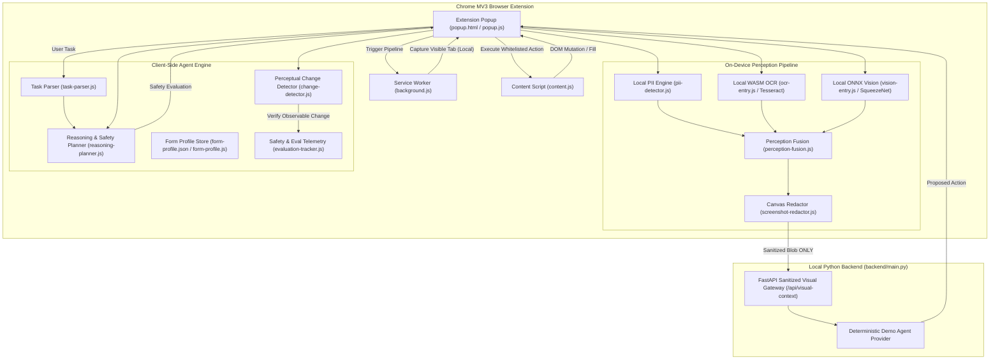

# SIH26171 — On-Device Visual Perception for Lightweight Browser Agents

> **Smart India Hackathon (SIH 2026)**  
> **Problem Statement ID:** SIH26171  
> **Topic:** On-device Visual Perception for Lightweight Browser Agents  
> **Target Platform:** Google Chrome / Chromium-based Browsers (Manifest V3) + Local Python Backend

---

## 🌟 Executive Overview

Modern autonomous web agents often rely on sending full raw screenshots and unredacted DOM trees to remote cloud-hosted Large Multimodal Models (LMMs). This creates severe privacy risks, high latency, huge bandwidth consumption, and vulnerability to prompt injection or unauthorized state mutations.

**SIH26171** solves this with an **on-device, privacy-first perception and execution architecture**:
1. **On-Device Multi-Modal Perception**: Combines client-side DOM extraction, local WebAssembly OCR (Tesseract.js), and local ONNX Runtime Web vision classification (SqueezeNet) directly inside the browser.
2. **Zero Raw Data Exfiltration**: Strict client-side privacy barrier. Raw screenshots and private field values **never leave the user's browser**. Only locally redacted/sanitized screenshots and structured semantic metadata reach the gateway.
3. **Deterministic Local Reasoning & Safety Gate**: 4-tier risk classification taxonomy (`LOW`, `MEDIUM`, `HIGH`, `CRITICAL`). Consequential actions (e.g., Form Submission, Account Deletion, Financial Checkout) are **gated by mandatory human approval** with live DOM re-grounding and stale-approval invalidation.
4. **Simultaneous Profile Autofill**: Instant simultaneous multi-field population driven by `form-profile.json` and intelligent semantic synonym matching.
5. **Closed-Loop Verification & Bounded Recovery**: Perceptual change detection (32×32 grayscale hash + DOM diffing), stall guards, and bounded DOM re-perception.

---

## 🏛️ System Architecture



---

## 🚀 Key Features & Milestones

### 1. Privacy & Redaction Pipeline (Zero-Exfiltration Contract)
- **Local Regex & Pattern PII Detection**: Detects emails, phone numbers, credit cards, Social Security Numbers, and sensitive keywords client-side.
- **On-Device OCR Text Extraction**: Tesseract WebAssembly engine locates sensitive text rendered directly in images or canvas elements.
- **Canvas-Based Screenshot Redaction**: Obscures sensitive DOM bounding boxes and OCR bounding boxes offscreen with solid black privacy masks before any network transmission.
- **Field Value Isolation**: User-entered form values (`localValues`) remain strictly in browser memory. Network payloads transmit only sanitized intents (e.g., `{"type": "FILL", "fieldHint": "email"}`).

### 2. On-Device Vision & Perception Fusion
- **SqueezeNet 1.1 ONNX Model**: Client-side scene and page layout classification running via ONNX Runtime WebAssembly.
- **Perception Fusion Layer**: Unifies DOM node hierarchy, visible element bounding boxes, OCR tokens, and scene classification into a single structured observation context.

### 3. Client-Side Natural Language Task Parser
- **Deterministic Rule-Based Parser**: Operates completely offline without external generative AI APIs.
- **Multi-Clause & Sequential Splitting**: Parses complex tasks (e.g., *"fill full name as Sanketh and email as sanketh@example.com, then click submit"*).
- **Pronoun & Reference Resolution**: Normalizes ambiguous idioms (*"find submit button, then click that link"* $\to$ single grounded click).

### 4. Deterministic Reasoning & Safety Planner (Human-in-the-Loop)
- **4-Tier Action Taxonomy**:
  - `LOW`: Viewport scroll, filling non-sensitive inputs (Autonomous).
  - `MEDIUM`: Internal tab navigation, search filtering (Autonomous).
  - `HIGH`: Form submission, account registration, publishing content (Requires Human Approval).
  - `CRITICAL`: Financial checkout, account deletion, irreversible mutations (Requires Human Approval).
- **Interactive Approval Modal**: Renders both inside popup UI and as an in-page modal dialog.
- **Dynamic Invalidation**: If the target element moves, disappears, or the page URL changes while waiting for approval, the safety gate **immediately locks** and halts execution.

### 5. Simultaneous Form Autofill
- **Profile Store (`form-profile.json`)**: Pre-configured user profile (Name, Email, Phone, Address, City, Zip, Comments).
- **Semantic Field Mapping (`form-profile.js`)**: Matches any webpage input label, placeholder, name, or `aria-label` to profile fields.
- **Simultaneous Single-Pass Fill**: Commands like `"fill the form"` populate all matching fields across the DOM simultaneously in a single atomic pass with native event dispatching (`input`, `change`).

### 6. Closed-Loop Change Detection & Stall Guard
- **32×32 Grayscale Perceptual Hash**: Detects observable visual changes post-action.
- **DOM Signature Hashing**: Detects element count and structural changes.
- **Stall Guard**: Automatically halts agent loops if identical actions are proposed without observable screen changes.

### 7. Evaluation & Benchmark Telemetry (`evaluation-tracker.js`)
- **Live Safety Telemetry**: Embedded live dashboard in extension popup.
- **Target Guarantee**: **Zero Unauthorized Consequential Actions** (100% of consequential actions gated and audited).

---

## 📁 Repository Structure

```text
SIH 2026/
├── backend/                               # Python Backend Service & Test Suite
│   ├── main.py                            # FastAPI Sanitized Visual Gateway & Demo Agent Provider
│   ├── requirements.txt                   # Python dependencies (fastapi, uvicorn, pytest, requests)
│   ├── test_generic_agent.py              # Tests for generic task parsing & perception
│   ├── test_m13.py                        # Tests for visual context gateway validation
│   ├── test_m14.py                        # Tests for semantic tags & keyword resolution
│   ├── test_m15.py                        # Tests for generalized grounding & fuzzy matching
│   ├── test_m16_final.py                  # Tests for form fill privacy & allowlists
│   ├── test_m17_production_hardening.py   # Tests for Google Forms & dynamic SPAs
│   ├── test_reasoning_and_approval.py     # Tests for 4-tier risk gate & human approval
│   ├── test_simultaneous_fill.py          # Tests for form-profile.json & simultaneous fill
│   └── test_ultimate_31_acceptance.py     # Ultimate 31 Acceptance Criteria test suite
│
├── demo-pages/                            # Comprehensive Test & Demo Web Pages
│   ├── accessibility-form.html            # ARIA-labeled & screen-reader form
│   ├── article.html                       # Long content reading & scrolling demo
│   ├── controls.html                      # Interactive widgets, toggles, checkboxes
│   ├── dynamic.html                       # Dynamic DOM mutation & AJAX loading demo
│   ├── generic-form.html                  # Standard web form fixture
│   ├── login.html                         # Login authentication form demo
│   ├── navigation.html                    # Multi-page navigation demo
│   ├── search.html                        # Search bar & query results demo
│   ├── shopping.html                      # E-commerce checkout fixture (High/Critical Risk)
│   ├── simple-form.html                   # Basic 2-field form fixture
│   └── test-simultaneous-form.html        # Comprehensive simultaneous profile fill demo
│
├── lib/                                   # Bundled Client-Side WebAssembly Libraries
│   ├── vision.bundle.js                   # Bundled ONNX Runtime Web library
│   ├── ocr.bundle.js                      # Bundled Tesseract.js OCR engine
│   └── ocr/                               # Tesseract WASM binaries & trained language data
│
├── background.js                          # Chrome MV3 Service Worker (Local Screenshot Capture)
├── change-detector.js                     # 32x32 Perceptual Hash & DOM Change Detector
├── content.js                             # Injected Content Script (DOM Perception & Safe Execution)
├── evaluation-tracker.js                  # Safety KPI, Benchmark & Zero-Violation Tracker
├── form-profile.js                        # Form Profile Manager & Semantic Synonym Matcher
├── form-profile.json                      # Local User Profile Configuration
├── manifest.json                          # Chrome Extension Manifest V3 Definition
├── perception-fusion.js                   # Multimodal Perception Fusion Layer
├── pii-detector.js                        # Client-side Regex PII Detection Engine
├── popup.html                             # Browser Extension Popup Interface
├── popup.js                               # Extension Main Orchestrator & Bounded Execution Loop
├── reasoning-planner.js                   # On-Device Reasoning Planner & Safety Gate
├── screenshot-redactor.js                 # Offscreen HTML5 Canvas Privacy Redactor
├── squeezenet1.1-7.onnx                   # On-Device SqueezeNet 1.1 ONNX Neural Model
├── task-parser.js                         # Deterministic Natural Language Task Parser
├── test-change-detector.js                # Node.js Unit Tests for Change Detector
├── test-simultaneous-fill.js              # Node.js Unit Tests for Simultaneous Form Autofill
├── test-task-parser-and-loop.js           # Node.js Unit Tests for Task Parser & Bounded Loop
└── README.md                              # Complete Project Documentation
```

---

## ⚙️ Installation & Setup

### Prerequisites
- **Google Chrome** or any Chromium-based browser (Brave, Edge, Chromium).
- **Node.js** (v16+ recommended).
- **Python** (v3.10+ recommended).

### 1. Clone the Repository
```bash
git clone https://github.com/sanketh-mallikarjuna/SIH26171-Visual-Perception-Agent.git
cd "SIH 2026"
```

### 2. Install Python Dependencies
```bash
pip install -r backend/requirements.txt
```

### 3. Load Extension in Google Chrome
1. Open Google Chrome and navigate to `chrome://extensions/`.
2. Enable **Developer mode** (toggle switch in the top right corner).
3. Click **Load unpacked**.
4. Select the project root directory (`SIH 2026`).
5. The **SIH26171 - Visual Perception Agent** extension icon will appear in your Chrome toolbar.

---

## 🏃 Running the Application

### Step 1: Start the Local Backend Server
```bash
python -m uvicorn backend.main:app --host 127.0.0.1 --port 8000 --reload
```
The FastAPI backend will start at `http://127.0.0.1:8000` with:
- `POST /api/visual-context`: Sanitized visual agent endpoint.
- `POST /api/context`: Sanitized text-only context endpoint.
- Static file serving for test pages under `http://127.0.0.1:8000/demo-pages/`.

### Step 2: Open a Demo Test Page
Open a new Chrome tab and navigate to:
```text
http://127.0.0.1:8000/demo-pages/test-simultaneous-form.html
```
*(Or open any demo page in `demo-pages/`)*.

### Step 3: Run Agent Tasks from Extension Popup
1. Click the **SIH26171 Extension Icon** in Chrome.
2. Enter a natural language task into the **Agent Task Input** box, such as:
   - `fill the form` — *Fills all form fields simultaneously from `form-profile.json`*.
   - `fill the form, then click submit` — *Fills form fields simultaneously, then pauses for human approval before clicking Submit*.
   - `fill full name as Sanketh and email address as sanketh@example.com` — *Fills specific named fields*.
   - `scroll down 500 pixels` — *Safely scrolls viewport*.
   - `click Submit Registration` — *Triggers safety gate modal*.
3. Click **▶ Run Agent Task**.

---

## 🧪 Verification & Automated Testing

### 1. Run Python Backend Pytest Suite (123 Tests)
```bash
python -m pytest backend -v
```
**Output:**
```text
============================= 123 passed in 7.98s =============================
```

### 2. Run Node.js Unit Tests
```bash
# Test simultaneous form autofill and profile mapping
node test-simultaneous-fill.js

# Test task parser, connectors, and multi-field loops
node test-task-parser-and-loop.js

# Test 32x32 perceptual hashing & DOM change detection
node test-change-detector.js
```

---

## 🔒 Security & Privacy Guarantees

| Requirement | Implementation | Guarantee |
| :--- | :--- | :--- |
| **Raw Screenshots** | Masked locally in `screenshot-redactor.js` | **NEVER** transmitted over network. |
| **User Input Values** | Retained strictly in client-side memory (`localValues`) | **NEVER** exposed in network payloads or trace logs. |
| **Password Fields** | Explicitly blocked in `content.js` | Refuses to fill sensitive credentials. |
| **Consequential Actions** | Gated by `reasoning-planner.js` | Zero unauthorized executions without user approval. |
| **Stale Approvals** | Invalidated on page drift / URL change | Approvals cannot be hijacked or replayed. |
| **Execution Allowlist** | Whitelist in `content.js` | Restricts execution strictly to safe primitives (`CLICK`, `SCROLL`, `FILL`, `FILL_FORM`). |

---

## 👥 Contributors & Acknowledgements

- **Team**: SIH26171 Developer Team
- **Competition**: Smart India Hackathon 2026 (SIH 2026)
- **Problem Statement**: SIH26171 — On-device Visual Perception for Lightweight Browser Agents
